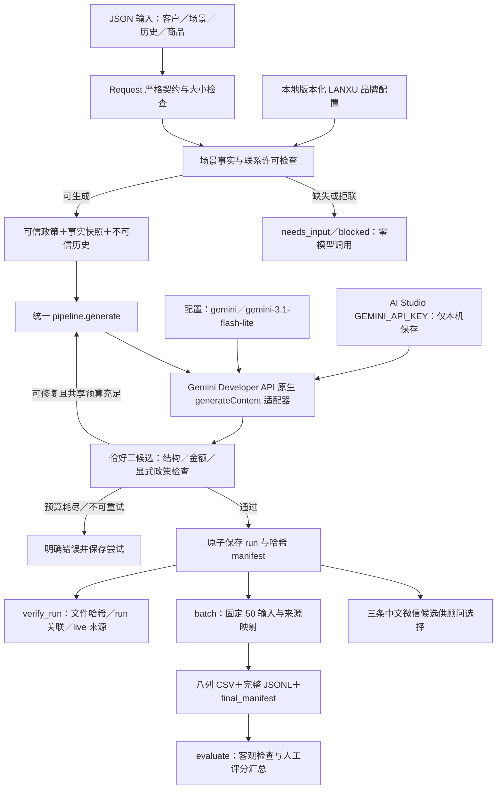

# 工具架构

CLI 生成与批量生成共用核心函数。运行与评估分开：生成成功说明契约与存储通过，不代表人工已批准发送。provider 和 storage 可注入以验证认证、超时、坏输出、限流、重试上限和写盘失败；测试注入来源标记为 mock，不能进入真实最终材料。

运行证据包括输入、上下文／提示词、attempt、result 和 manifest。相同 request_id 重跑产生新 run_id；历史不会被覆盖。provider、原生端点、模型、品牌、提示词、schema、源码摘要和评估版本使结果可追溯。`GEMINI_API_KEY` 只从环境或本地 `.env` 读取，不进入截图、源码或记录。

默认使用 Gemini Developer API，模型为 `gemini-3.1-flash-lite`，原生地址为 `https://generativelanguage.googleapis.com/v1beta/models/gemini-3.1-flash-lite:generateContent`。API key 已关联后台项目，调用配置不填写 Cloud 项目／区域，也不使用 ADC。其他适配器只能显式选择，不做隐藏回退。[官方接口](https://ai.google.dev/api/generate-content)；[key 与项目关联](https://ai.google.dev/gemini-api/docs/api-key)。

轻量模型用于控制开发成本，话术质量仍须实际测试。官方 [Gemini 定价](https://ai.google.dev/gemini-api/docs/pricing) 列出该模型的 Free Tier 标准输入／输出免费；付费层文本输入为 USD 0.25／百万 token、输出为 USD 1.50／百万 token。实际免费模型权限与额度按当前项目核对，模型列表可见不等于生成通过；模型发现、真实生成和应用校验分别记录。[使用层级与配额](https://ai.google.dev/gemini-api/docs/billing)。

项目采用本地 JSON／JSONL 留档，批量工具导出 CSV 和来源清单。自动评估模块属于开发校验工具，不自动给出人工判断。

程序没有自动发送微信、真实 CRM、数据库或 RAG；未来接入这些组件时应补充事实契约与回归验证。报告、截图和提交材料由使用者独立维护。
